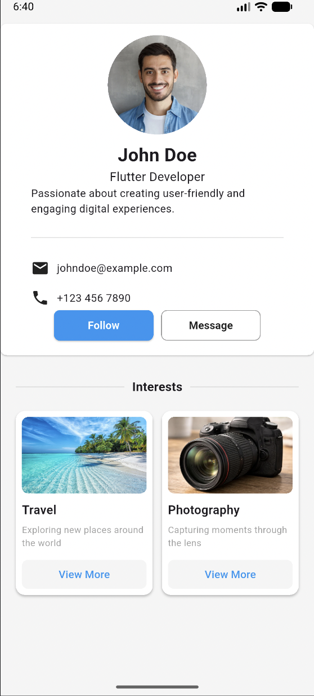

# Flutter Profile Card UI
---
A simple and elegant Profile Card UI built with Flutter using reusable widgets and a clean layout.
## Screenshot
---

## About the Project
---
This project demonstrates how to create a profile card interface using Flutter widgets. The card displays a profile picture, name, professional title, short bio, contact information, and action buttons.

The `ProfileCard` is implemented as a separate `StatelessWidget` to keep the code organized, reusable, and easy to maintain.

## Features
---
- Profile picture using `CircleAvatar` and `AssetImage`
- Name and professional title
- Short profile description
- Email and phone number
- Follow and Message buttons
- Rounded corners and clean card design
- Reusable custom widget using `StatelessWidget`

## Technologies Used
---
- Flutter
- Dart
- Material Design Widgets

## Project Structure

```text
lib/
└── widgets/
    └── profile_card.dart

assets/
└── images/
    └── profile.jpeg
    └── Interest-Cards.jpeg
    └── Interests-Heading.jpeg

screenshots/
└── profile-card.png
```
## Getting Started
---
1. Clone the repository:

   ```bash
   git clone https://github.com/mazbaul20/Assignment-b19-m8
   ```

2. Navigate to the project directory:

   ```bash
   cd Assignment-b19-m8
   ```

3. Install dependencies:

   ```bash
   flutter pub get
   ```

4. Run the application:

   ```bash
   flutter run
   ```

## Learning Outcomes
---
- Understanding Flutter's `StatelessWidget`
- Creating reusable custom widgets
- Working with `Card`, `Column`, and `Row`
- Displaying local images using assets
- Styling buttons, text, icons, and dividers
- Organizing Flutter UI code

## Author

**Md Mazbaul Islam**

---

*Created as part of a Flutter UI assignment.*
